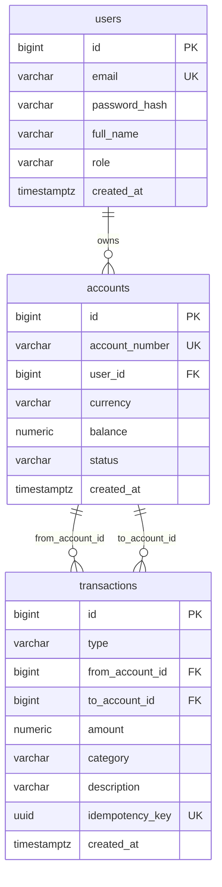

# Mini-Bank API

[](https://github.com/amyrrh/mini-bank-api/actions/workflows/ci.yml)

Учебный REST API мини-банка: пользователи, счета в RUB/USD/EUR, пополнение, переводы, история операций, выписка за период и аналитика расходов.

## Стек

- Java 21, Spring Boot 3, Maven
- Spring Data JPA, Hibernate, PostgreSQL, Flyway
- Spring Security, JWT
- Bean Validation, MapStruct, Lombok
- JUnit 5, Mockito, Testcontainers
- Docker Compose, Swagger UI, GitHub Actions

## Запуск

Нужен Docker. Команда соберёт приложение и запустит его вместе с PostgreSQL:

```bash
docker compose up --build
```

Для разработки можно запустить в Docker только базу (порт 5433), а приложение — из IDE или через Maven Wrapper (нужен JDK 21):

```bash
docker compose up -d postgres
./mvnw spring-boot:run
```

Swagger UI: <http://localhost:8080/swagger-ui.html>

Как отправить запрос из Swagger UI:

1. Зарегистрироваться через `POST /api/auth/register`.
2. Получить токен через `POST /api/auth/login`.
3. Нажать **Authorize** и вставить `accessToken`.

При старте создаётся администратор `admin@minibank.local` с паролем `admin12345`. Это значения для локального запуска. В другой среде нужно задать переменные `ADMIN_EMAIL`, `ADMIN_PASSWORD` и `JWT_SECRET`.

## API

| Метод | Путь | Описание | Доступ |
|---|---|---|---|
| POST | `/api/auth/register` | регистрация | все |
| POST | `/api/auth/login` | вход, возвращает JWT | все |
| GET, PATCH | `/api/users/me` | профиль, смена имени | пользователь |
| POST, GET | `/api/accounts` | открыть счёт, список своих счетов | пользователь |
| GET | `/api/accounts/{id}` | свой счёт | пользователь |
| POST | `/api/accounts/{id}/close` | закрыть счёт с нулевым балансом | пользователь |
| POST | `/api/accounts/{id}/deposit` | пополнение, нужен `Idempotency-Key` | пользователь |
| POST | `/api/transfers` | перевод по номеру счёта, нужен `Idempotency-Key` | пользователь |
| GET | `/api/accounts/{id}/transactions` | история: `type`, `from`, `to`, `page`, `size` | пользователь |
| GET | `/api/accounts/{id}/statement` | выписка за период: `from`, `to` | пользователь |
| GET | `/api/analytics/expenses` | расходы по категориям: `from`, `to` | пользователь |
| GET | `/api/admin/users` | список пользователей | ADMIN |

Все ошибки возвращаются в едином формате:

```json
{
  "timestamp": "2026-11-02T10:00:00Z",
  "status": 422,
  "error": "Unprocessable Entity",
  "message": "Account is already closed",
  "path": "/api/accounts/1/close"
}
```

## Схема базы данных



Схема меняется только миграциями Flyway, Hibernate работает в режиме `ddl-auto=validate`.

## Технические решения

**Защита от гонок.** Перевод выполняется в одной транзакции и блокирует оба счёта через `SELECT ... FOR UPDATE`. Выбрана пессимистичная блокировка: при оптимистичной конфликтующий запрос падает и его нужно повторять, а конкурирующие операции с одним счётом для денег обычны. Транзакция короткая, поэтому ожидание блокировки небольшое.

**Защита от дедлока.** Счета всегда блокируются в порядке возрастания `id`. Поэтому встречные переводы A→B и B→A не могут ждать друг друга. Если убрать этот порядок, тест со встречными переводами получает настоящий дедлок от PostgreSQL.

**Идемпотентность.** Клиент передаёт `Idempotency-Key` (UUID), ключ хранится в `transactions` с ограничением `UNIQUE`. Повтор запроса с тем же ключом возвращает уже созданную операцию. Ключ проверяется после получения блокировки: одновременный повтор дожидается завершения первого запроса и видит его результат.

**Деньги.** В коде только `BigDecimal`, в базе `NUMERIC(19,2)`. Суммы с тремя знаками после запятой отклоняются, а не округляются. `CHECK (balance >= 0)` защищает баланс на уровне базы, даже если в коде окажется ошибка.

**N+1.** В истории операций нужны номера обоих счетов, поэтому они загружаются через `join fetch`. Страница из 20 операций с разными счетами выполняет 2 SQL-запроса вместо 22. Отдельный тест считает запросы и не даст проблеме вернуться.

**Индексы.** История ищется по счёту и периоду, поэтому используются составные индексы `(from_account_id, created_at)` и `(to_account_id, created_at)`. Замер `EXPLAIN ANALYZE` на 100 тысячах операций, запрос за месяц по одному счёту, найдено 412 строк (один прогон, время приблизительное):

| Индексы | Отброшено строк | Прочитано страниц | Время |
|---|---|---|---|
| нет | 99 648 | 1236 | 16 мс |
| одиночные | 4 588 | 1243 | 4 мс |
| составные | 0 | 321 | 2 мс |

**Выписка.** Баланс и суммы читаются разными запросами, поэтому метод работает с уровнем изоляции `REPEATABLE READ`: все запросы видят один снимок данных, даже если параллельно проходит перевод.

**Безопасность.** Токен проверяется в собственном фильтре, сервер не хранит сессий. Пароли хешируются BCrypt. Чужой счёт возвращает 404, а не 403, чтобы не раскрывать его существование. При неверном email и неверном пароле ответ одинаковый.

## Тесты

Для запуска нужен Docker:

```bash
./mvnw test
```

- **Unit-тесты** (JUnit 5, Mockito): правила счёта, логика переводов, порядок блокировок, регистрация, вход, JWT.
- **Интеграционные тесты** (MockMvc, Testcontainers): API, права доступа, выписка, аналитика и параллельные операции на настоящем PostgreSQL.

H2 не используется: блокировки, изоляция и дедлоки нужно проверять на той же СУБД, что и в работе.
